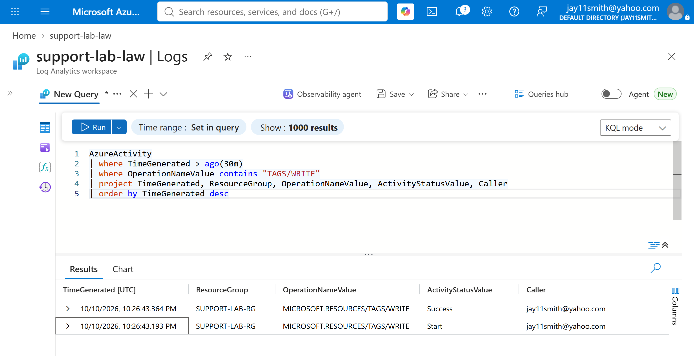
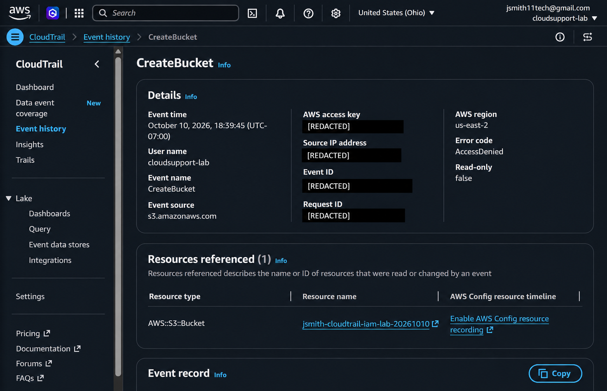
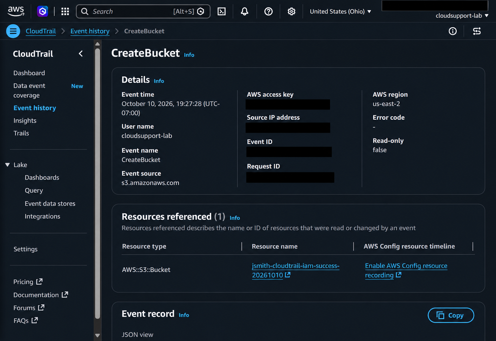
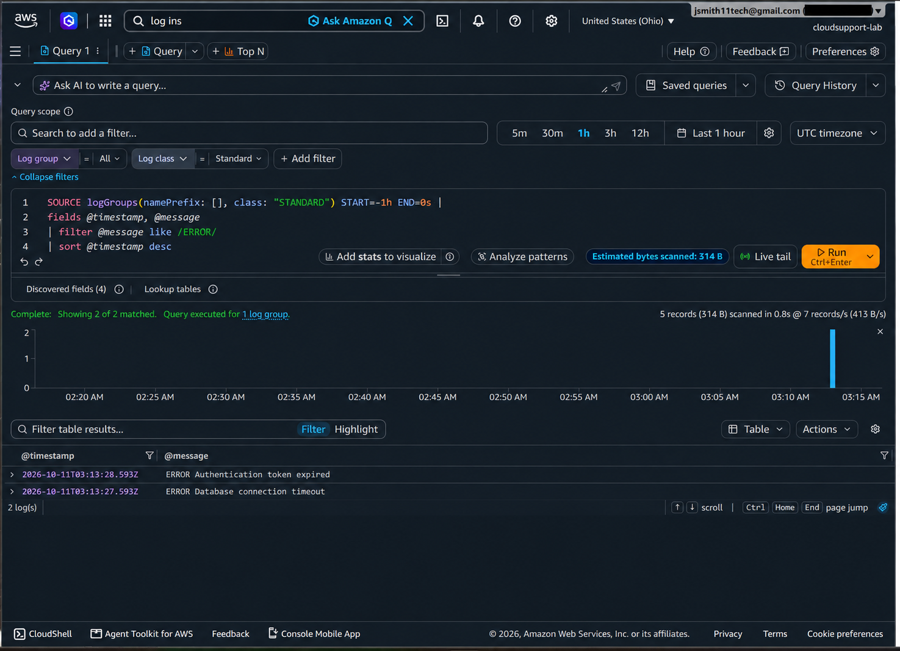

# Cloud Support Labs

Hands-on support engineering portfolio focused on Azure troubleshooting, identity and access management, logging, and technical investigation.

This repository combines scenario-based troubleshooting with live exercises completed in a Microsoft Azure lab environment.

---

## Live Azure Work

### Azure Activity Log Investigation

I generated activity in Azure, routed Activity Log data into Log Analytics, and used KQL to isolate and investigate specific operations.

~~~kusto
AzureActivity
| where TimeGenerated > ago(30m)
| where OperationNameValue contains "TAGS/WRITE"
| project TimeGenerated, ResourceGroup, OperationNameValue, ActivityStatusValue, Caller
| order by TimeGenerated desc
~~~

[View the full live Azure lab](azure/live-labs.md)

---

## Skills Demonstrated

### Azure & Logging

- Azure Activity Log
- Log Analytics
- Kusto Query Language (KQL)
- Resource and configuration change investigation
- Failed deployment analysis
- Azure RBAC troubleshooting

### Identity & Access Management

- Microsoft Entra ID concepts
- Conditional Access
- MFA troubleshooting
- Device compliance
- Authentication strength
- Sign-in risk
- Guest / B2B access
- Enterprise application assignments
- Application roles
- Authentication vs. authorization
- Refresh-token and session troubleshooting

### KQL

- `where`
- `project`
- `contains`
- `ago()`
- `order by`
- `take`
- `summarize`
- `count()`
- `distinct`
- combined conditions with `and`

---

## AWS CloudTrail and CloudWatch

### IAM Authorization Troubleshooting

A real S3 `CreateBucket` request was captured in CloudTrail first as an `AccessDenied` event and then as a successful event after correcting IAM permissions through a user group.

### CloudWatch Logs Insights

CloudWatch Logs Insights was used to isolate error messages from a support-oriented log stream.

~~~text
fields @timestamp, @message
| filter @message like /ERROR/
| sort @timestamp desc
~~~

[View the full AWS live lab](aws/live-labs.md)

---
## Troubleshooting Labs

### Microsoft Entra Sign-In Logs

Scenario-based investigations involving authentication, Conditional Access, device compliance, MFA, sign-in risk, guest access, application assignments, and token behavior.

[View Entra troubleshooting scenarios](azure/entra-signin-logs/ticket-labs.md)

### Azure Activity Logs

Investigations involving RBAC authorization, resource deletion, configuration changes, and failed deployments.

[View Azure Activity Log scenarios](azure/activity-logs/ticket-labs.md)

### Live Azure / KQL

Hands-on exercises performed using real Azure Activity Log data and Log Analytics.

[View live Azure exercises](azure/live-labs.md)

---

## Approach

The goal of these labs is not syntax memorization.

The focus is on using available evidence to:

1. Identify what succeeded and what failed
2. Separate authentication, authorization, configuration, and resource failures
3. Narrow logs to the relevant events
4. Identify the likely cause
5. Determine the appropriate next troubleshooting step

---

## Related Work

Additional repositories cover SQL support investigation and API / Postman troubleshooting.

---

## Lab Environment

Live exercises were completed in a personal Microsoft Azure environment.

Sensitive account, subscription, or credential information is redacted where appropriate.

