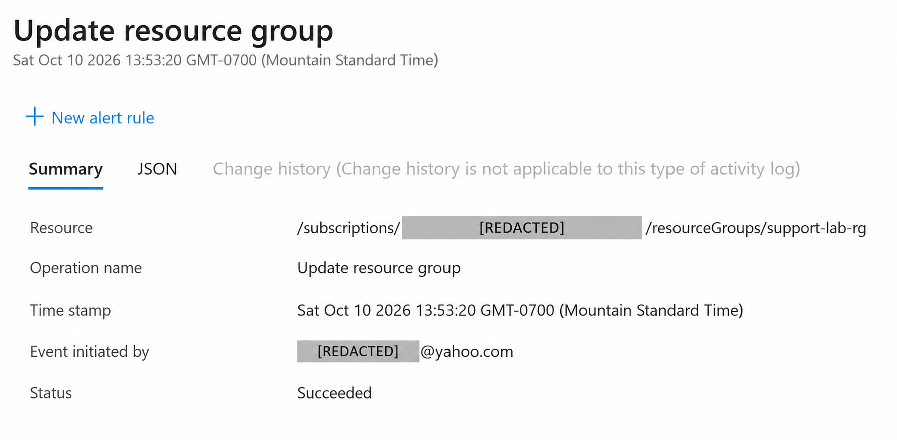
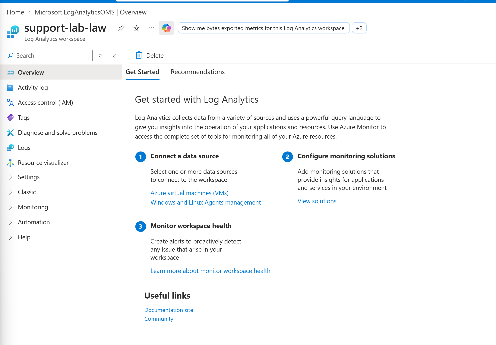
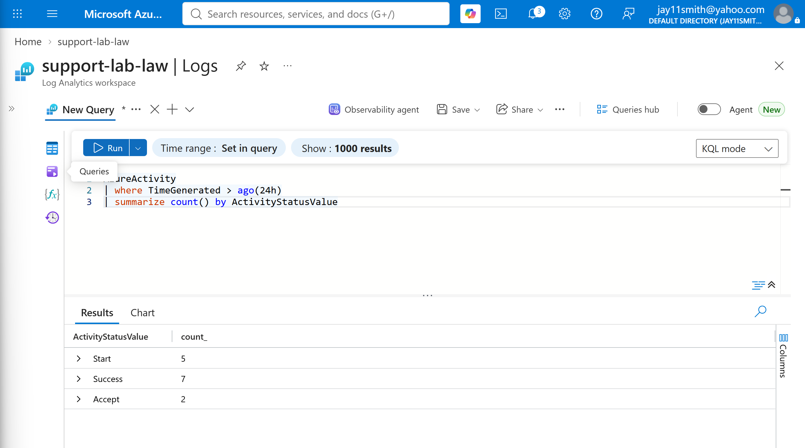
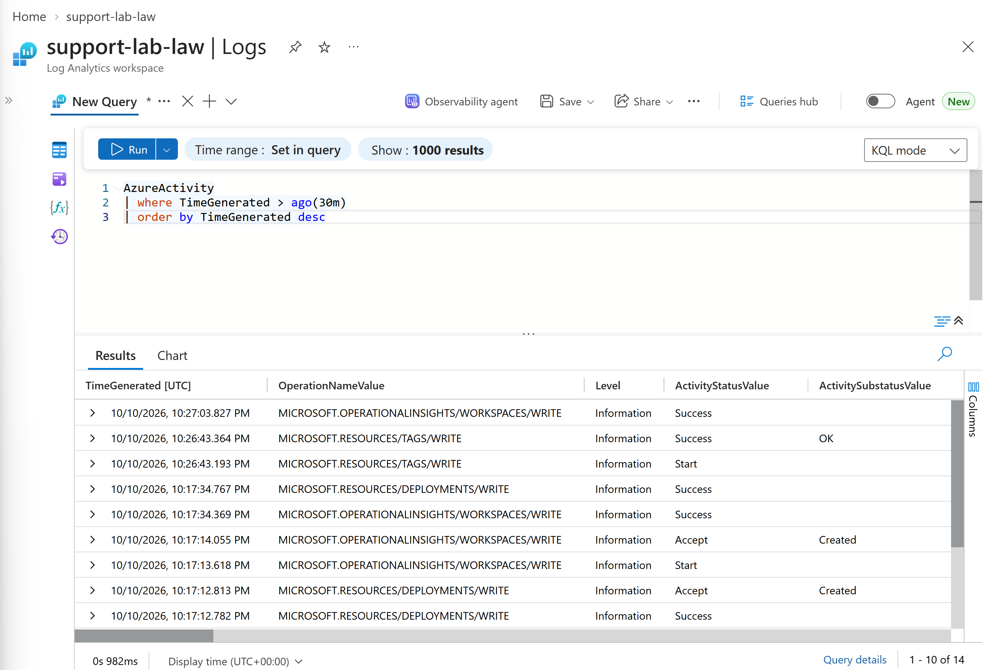
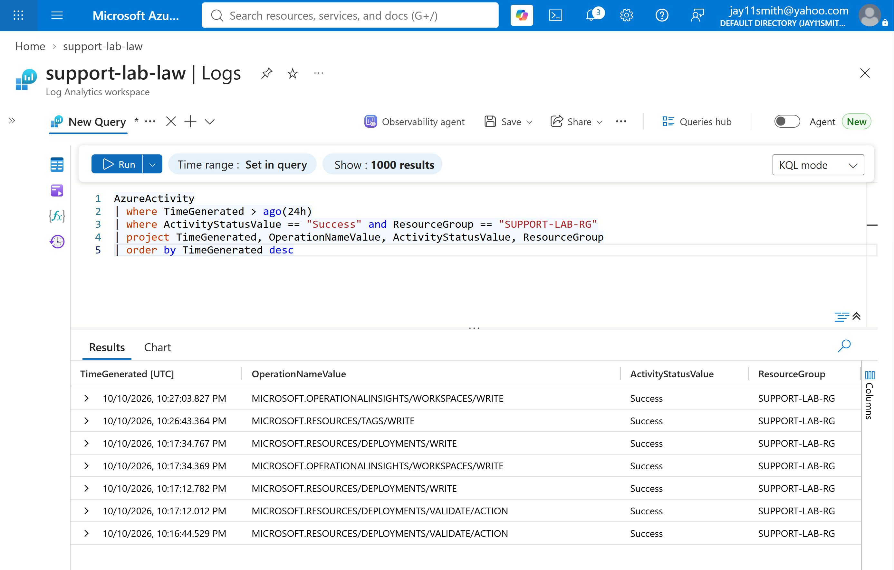

# Live Azure Activity Log and KQL Labs

These exercises were completed in a personal Microsoft Azure lab environment using real Azure Activity Log data and Log Analytics.

Sensitive account or subscription identifiers are redacted where appropriate.

## Resource Group Activity

I created `support-lab-rg` and inspected the corresponding Azure Activity Log event.

Skills demonstrated:

- Navigating Azure Activity Log
- Identifying control-plane operations
- Reviewing timestamps and resource context
- Distinguishing successful administrative activity from failures

## Log Analytics Workspace

I created `support-lab-law` and configured Azure Activity Log data for investigation through Log Analytics.

## Querying Recent Azure Activity

~~~kusto
AzureActivity
| where TimeGenerated > ago(30m)
| order by TimeGenerated desc
~~~

## Filtering a Known Operation

I generated a tag update in Azure and isolated the resulting operation with KQL.

~~~kusto
AzureActivity
| where TimeGenerated > ago(30m)
| where OperationNameValue contains "TAGS/WRITE"
| project TimeGenerated, ResourceGroup, OperationNameValue, ActivityStatusValue, Caller
| order by TimeGenerated desc
~~~

## Aggregating Activity Status

~~~kusto
AzureActivity
| where TimeGenerated > ago(24h)
| summarize count() by ActivityStatusValue
~~~

## Finding Unique Operations

~~~kusto
AzureActivity
| where TimeGenerated > ago(24h)
| distinct OperationNameValue
| order by OperationNameValue asc
~~~

## Combining Conditions

~~~kusto
AzureActivity
| where TimeGenerated > ago(24h)
| where ActivityStatusValue == "Success" and ResourceGroup == "SUPPORT-LAB-RG"
| project TimeGenerated, OperationNameValue, ActivityStatusValue, ResourceGroup
| order by TimeGenerated desc
~~~

## Skills Demonstrated

- Azure Activity Log investigation
- Log Analytics
- KQL filtering and relative time ranges
- `project` and column selection
- `contains`
- `order by`
- `summarize` and `count()`
- `distinct`
- Combined conditions with `and`
